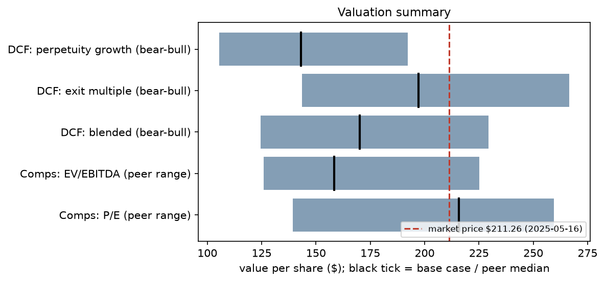
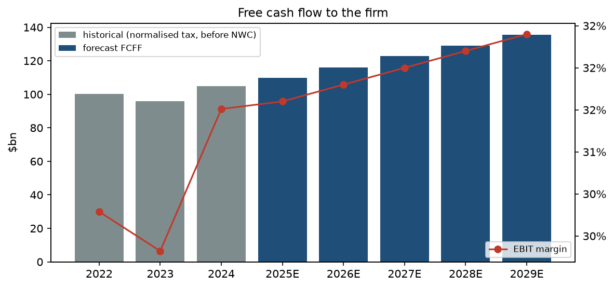
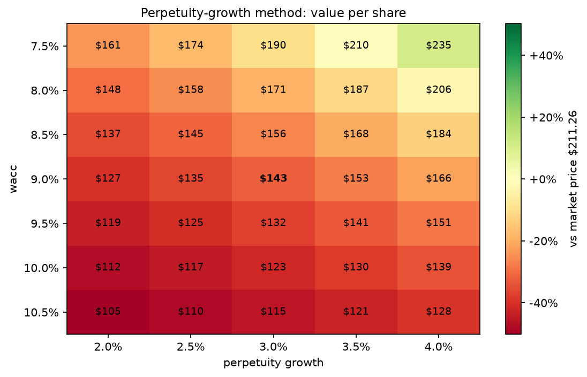
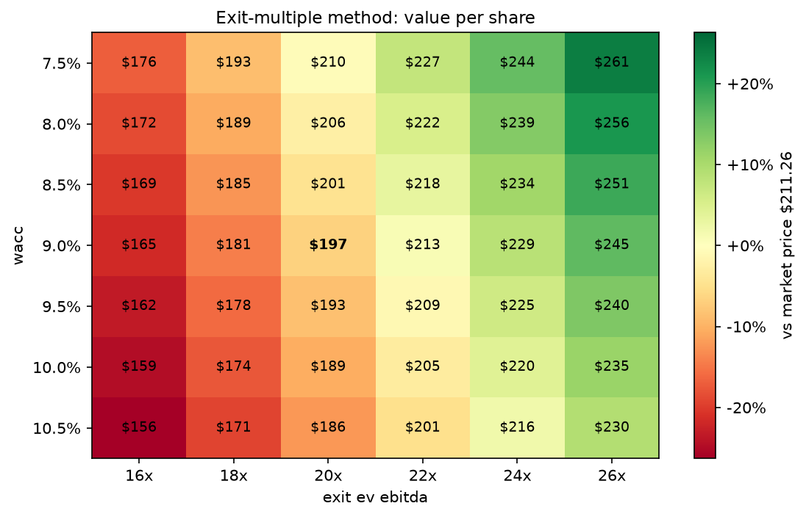
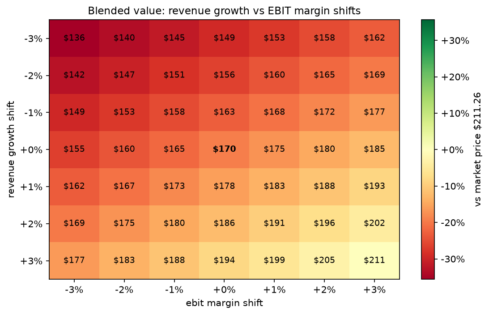
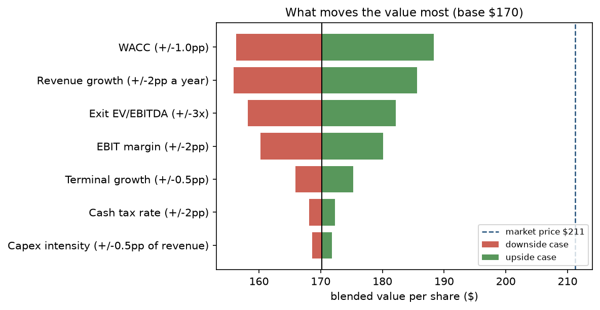
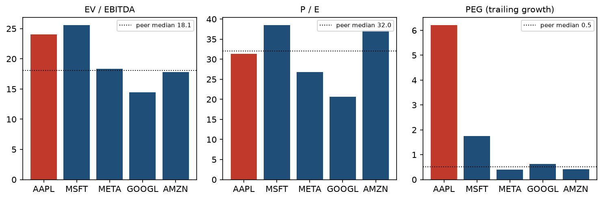
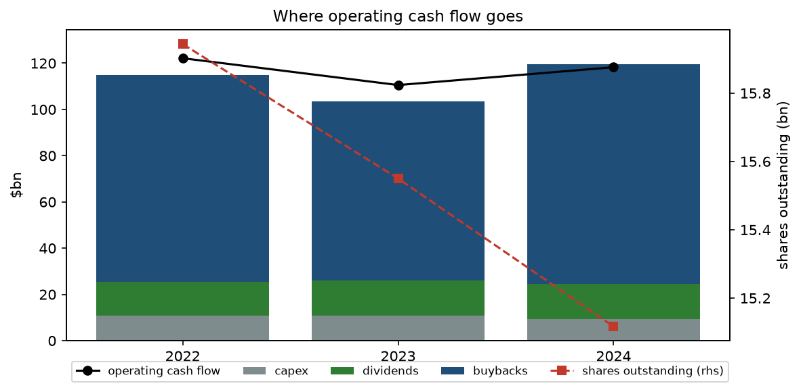

# AAPL valuation report

**Valuation date:** 2025-05-16 | **Price:** $211.26 (close 2025-05-16) | **Base year:** FY2024 (latest 10-K public on the valuation date)

## Answer
- **Intrinsic value: $170.21 per share** (50/50 blend of perpetuity growth $143.12 and exit multiple $197.29).
- The market price is **+24.1%** relative to intrinsic value. The market is pricing in more growth, margin or a lower discount rate than the base case.
- Scenario range: bear $124.59, base $170.21, bull $229.40.

## Cost of capital
| Input | Value | Source |
|---|---:|---|
| Risk-free rate | 4.44% | 10-year US Treasury yield on 2025-05-16 |
| Beta (adjusted) | 1.05 | raw 1.07 from 104 weekly returns vs S&P 500, 2023-05-26 to 2025-05-16 (R² 0.40, s.e. 0.13); Blume-adjusted 0.67·raw + 0.33 |
| Equity risk premium | 4.50% | assumption |
| Cost of equity (CAPM) | 9.16% | rf + β × ERP |
| Pre-tax cost of debt | 5.04% | rf + 0.60% spread |
| After-tax cost of debt | 3.98% | at 21% marginal tax |
| Weights E / D | 96.8% / 3.2% | market cap $3,193.6bn, debt $106.6bn |
| **WACC** | **8.99%** | |

## Free cash flow forecast ($bn)
| | FY2025E | FY2026E | FY2027E | FY2028E | FY2029E |
|---|---:|---:|---:|---:|---:|
| Revenue | 408.6 | 431.1 | 454.8 | 477.6 | 499.0 |
| Growth | 4.5% | 5.5% | 5.5% | 5.0% | 4.5% |
| EBIT | 129.1 | 137.1 | 145.5 | 153.8 | 161.7 |
| EBIT margin | 31.6% | 31.8% | 32.0% | 32.2% | 32.4% |
| Cash taxes | 21.3 | 22.6 | 24.0 | 25.4 | 26.7 |
| NOPAT | 107.8 | 114.5 | 121.5 | 128.4 | 135.0 |
| + D&A | 11.9 | 12.5 | 13.2 | 13.8 | 14.5 |
| - Capex | 10.6 | 12.1 | 13.2 | 14.3 | 15.0 |
| - Change in NWC | -0.9 | -1.1 | -1.2 | -1.1 | -1.1 |
| **FCFF** | 109.9 | 116.0 | 122.7 | 129.1 | 135.6 |
| Discount factor (mid-year) | 0.958 | 0.879 | 0.806 | 0.740 | 0.679 |
| PV of FCFF | 105.3 | 102.0 | 98.9 | 95.5 | 92.0 |

## Terminal value
| | Perpetuity growth | Exit multiple |
|---|---:|---:|
| Assumption | g = 3.0% | 20.0x FY2029 EBITDA |
| Terminal value | $2,330.8bn | $3,523.3bn |
| PV of terminal value | $1,515.5bn | $2,290.8bn |
| PV of FCFF FY2025-FY2029 | $493.7bn | $493.7bn |
| Enterprise value (at FY2024 year end) | $2,009.2bn | $2,784.5bn |
| Terminal value share of EV | 75% | 82% |
| Cross-check | implies 13.2x EBITDA | implies g = 4.95% |
| **Value per share at valuation date** | **$143.12** | **$197.29** |

Equity bridge: EV + net cash $50.0bn (cash, short- and long-term marketable securities less total debt), ÷ 15.12bn shares, rolled forward 0.62 years at the cost of equity, less $0.76 of dividends paid in between.

## Scenarios
| Scenario | Revenue growth | EBIT margin | WACC | g | Exit | Perpetuity | Exit multiple | Blended | Price vs value |
|---|---:|---:|---:|---:|---:|---:|---:|---:|---:|
| bear | 2.5% avg | 30.4% FY2029 | 9.49% | 2.5% | 17x | $105.54 | $143.64 | **$124.59** | +70% |
| base | 5.0% avg | 32.4% FY2029 | 8.99% | 3.0% | 20x | $143.12 | $197.29 | **$170.21** | +24% |
| bull | 7.0% avg | 33.9% FY2029 | 8.49% | 3.5% | 24x | $192.17 | $266.62 | **$229.40** | -8% |

## Sensitivity
Ranges tested: WACC 7.49%-10.49%, terminal growth 2.0%-4.0%, exit multiple 16x-26x, revenue growth and EBIT margin ±3% points.

| Driver (one at a time) | Low | High | Swing | % of base |
|---|---:|---:|---:|---:|
| WACC (+/-1.0pp) | $156.28 | $188.37 | $32.09 | 19% |
| Revenue growth (+/-2pp a year) | $155.86 | $185.65 | $29.79 | 18% |
| Exit EV/EBITDA (+/-3x) | $158.20 | $182.21 | $24.01 | 14% |
| EBIT margin (+/-2pp) | $160.28 | $180.13 | $19.85 | 12% |
| Terminal growth (+/-0.5pp) | $165.89 | $175.31 | $9.42 | 6% |
| Cash tax rate (+/-2pp) | $168.13 | $172.29 | $4.16 | 2% |
| Capex intensity (+/-0.5pp of revenue) | $168.59 | $171.82 | $3.23 | 2% |

## Trading comparables (last fiscal year public on the valuation date)
| Company | FY | Price | EV/EBITDA | P/E | EPS growth (CAGR, yrs) | PEG |
|---|---:|---:|---:|---:|---:|---:|
| AAPL | 2024 | $211.26 | 24.0x | 31.3x | 5.0% (2y) | 6.21 |
| MSFT | 2024 | $454.27 | 25.6x | 38.5x | 21.9% (1y) | 1.76 |
| META | 2024 | $640.34 | 18.4x | 26.8x | 66.7% (2y) | 0.40 |
| GOOGL | 2024 | $166.19 | 14.4x | 20.7x | 32.8% (2y) | 0.63 |
| AMZN | 2024 | $205.59 | 17.8x | 37.2x | 90.7% (1y) | 0.41 |

Apple at peer-median EV/EBITDA (18.1x) is worth $158.40; at peer-median P/E (32.0x) $215.79. Apple's EPS is adjusted for the one-off $10.2bn FY24 tax charge.

## Capital allocation
| | FY2022 | FY2023 | FY2024 |
|---|---:|---:|---:|
| Operating cash flow | 122.2 | 110.5 | 118.3 |
| Capex | 10.7 | 11.0 | 9.4 |
| Free cash flow | 111.4 | 99.6 | 108.8 |
| Buybacks | 89.4 | 77.5 | 94.9 |
| Dividends | 14.8 | 15.0 | 15.2 |
| Returned as % of FCF | 94% | 93% | 101% |
| Stock-based compensation | 9.0 | 10.8 | 11.7 |
| Net cash | 36.6 | 51.0 | 50.0 |
| Change in shares outstanding | – | -2.5% | -2.8% |
| Buyback $ per net share retired | – | $197 | $219 |
| Net income growth | – | -2.8% | -3.4% |
| Diluted EPS growth | – | +0.3% | -0.8% |
| EPS growth from lower share count | – | +3.2% | +2.6% |

**Buybacks and per-share value.** Holding the business constant, five years of buybacks at the recent $87bn a year change intrinsic value per share by:

| Buyback price ÷ intrinsic value | Value per share after 5 years | Change |
|---:|---:|---:|
| 0.80 | $179.37 | +5.4% |
| 0.90 | $174.16 | +2.3% |
| 1.00 | $170.21 | +0.0% |
| 1.10 | $167.10 | -1.8% |
| 1.20 | $164.60 | -3.3% |
| 1.24 (market price) | $163.71 | -3.8% |

At the valuation-date price, continued buybacks would *dilute* intrinsic value per share by 3.8% over five years.

## Hindsight check (not used in the valuation)
- FY2025 revenue: forecast $408.6bn, reported $416.2bn (+1.8%).
- FY2025 EBIT margin: forecast 31.6%, reported 32.0%.
- FY2025 FCFF forecast $109.9bn vs reported free cash flow $98.8bn (not like-for-like: reported FCF is after interest, actual taxes and a large working-capital outflow).
- AAPL closed at $339.50 on 2026-10-20, +60.7% since the valuation date.
